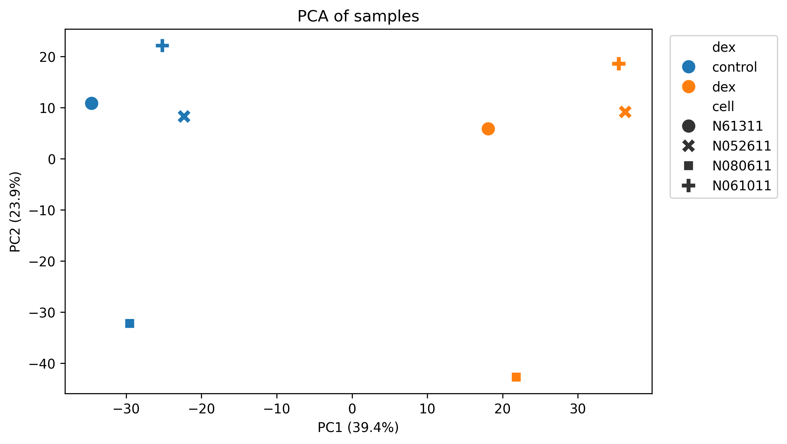
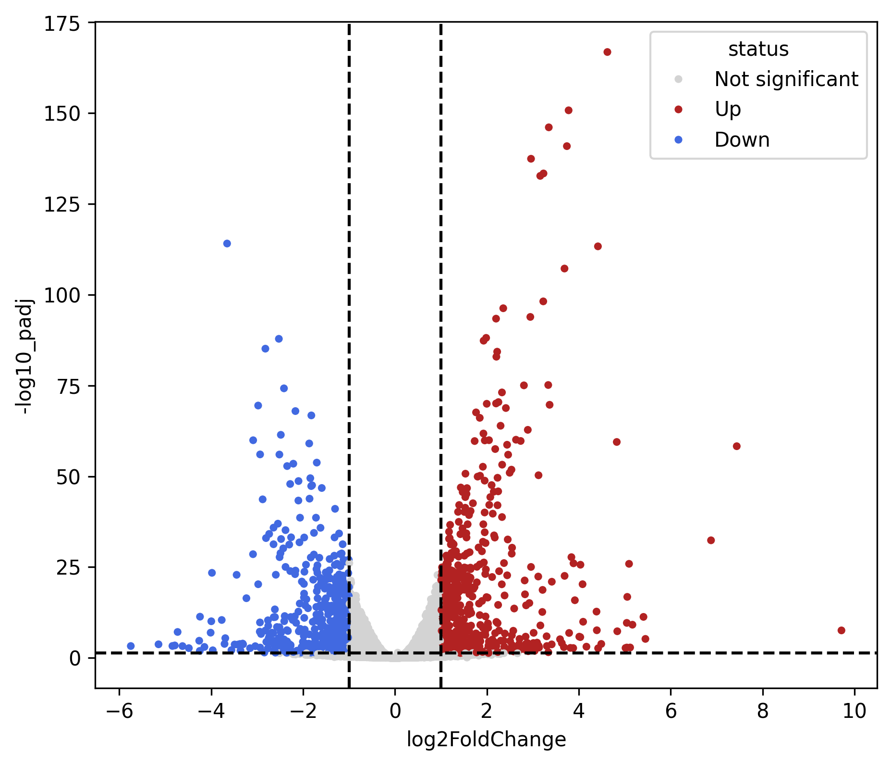
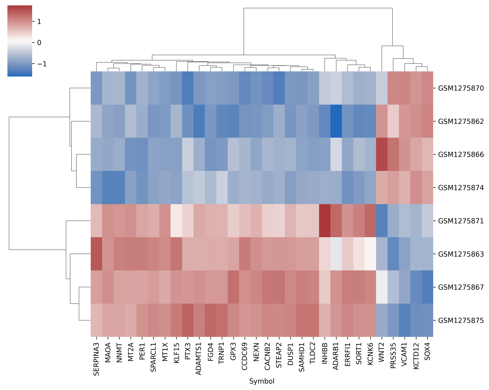

# RNA-seq reanalysis: dexamethasone response in airway smooth muscle cells

**Question:** Which genes change expression when human airway smooth muscle cells are treated with dexamethasone, a glucocorticoid used to treat asthma?

**Data:** GEO GSE52778 (Himes et al., 2014, PLoS One). Four primary human airway smooth muscle cell lines, each untreated and treated with 1 µM dexamethasone for 18 h (n = 8). I used the NCBI-generated raw count matrix and the NCBI human gene annotation table (GRCh38.p13) from the GEO download page.

**Tools:** Python, pandas, NumPy, scikit-learn, seaborn, matplotlib, PyDESeq2, gseapy (Google Colab).

## Methods
1. Kept the 8 control and dexamethasone samples and converted gene IDs to symbols.
2. Removed genes with fewer than 10 total reads.
3. Quality control: library sizes, PCA, sample correlation.
4. Differential expression with PyDESeq2 using a paired design (~cell + dex).
5. Significance: adjusted p < 0.05 (Benjamini-Hochberg) and |log2 fold change| > 1.
6. GO Biological Process enrichment (Enrichr, via gseapy) on up- and down-regulated genes.

## Results
- 18,446 genes tested; 1,171 significant (590 up, 581 down).
- CRISPLD2, the gene the original study followed up, was strongly up in dexamethasone (log2FC 2.63, adjusted p = 8.5e-61).
- PCA: PC1 (39.4%) separated treated from control samples; PC2 (23.9%) separated cell lines, supporting the paired design.
- Up-regulated genes were enriched for cell migration and motility terms (adjusted p = 0.005 to 0.021). These terms share most of their genes, so they are one finding.
- Down-regulated genes were enriched for axon guidance terms (adjusted p = 0.001 to 0.012).

## Comparison with the original study
The original study used TopHat/Cufflinks and reported 316 differentially expressed genes. All 17 top genes in its Table 1 were significant in my analysis and changed in the same direction (KCTD12 down, the others up). Log2 fold changes were within about 0.4 of the values calculated from the FPKM data in their table (CRISPLD2: 2.63 here vs. 2.70). I found more significant genes (4,548 at adjusted p < 0.05 before the fold-change cutoff), likely because of different software, a paired model, and a different reference annotation. [Optional: add the unpaired-model count here only if you ran that test.]

## Limitations
- Four replicates per condition, so only larger changes are reliably detected.
- One dose and one time point (18 h); cells from donors without asthma.
- Counts were generated by NCBI's pipeline and can differ slightly from the paper's.
- Enrichment used Enrichr's default background, not only the 18,446 tested genes, which can make pathways look more significant.
- RNA changes do not prove protein or functional changes; top genes would need validation, for example by qPCR with a reference gene.

## Figures

## How to run
1. Open the notebook in Google Colab.
2. Download the raw counts file and annotation file from the GSE52778 download page on GEO and upload them as `counts.tsv.gz` and `annot.tsv.gz`.
3. Run all cells.

## Reference
Himes BE, et al. (2014) RNA-Seq Transcriptome Profiling Identifies CRISPLD2 as a Glucocorticoid Responsive Gene that Modulates Cytokine Function in Airway Smooth Muscle Cells. PLoS ONE 9(6): e99625.# rnaseq-analysis
